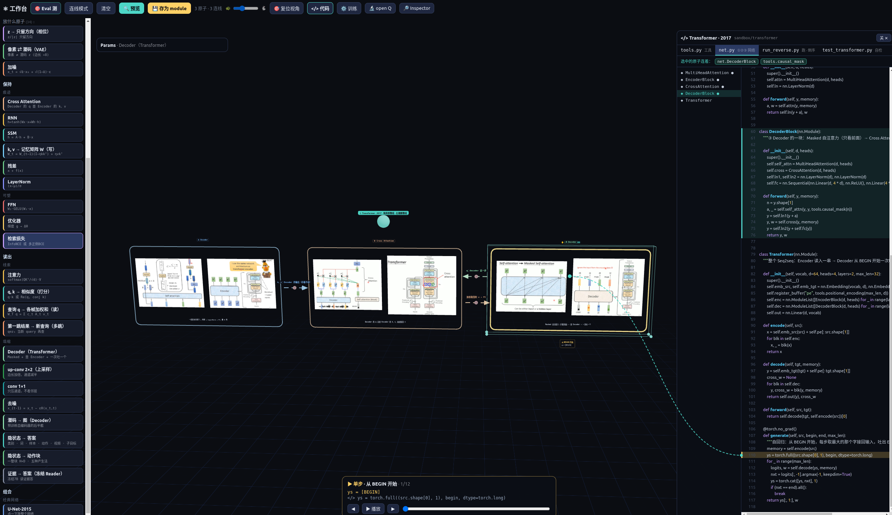

<h2>可视化 · Visualization</h2>

2026/11/16

<h3>算法广场 · Algorithm Playground</h3>

数学是流动的想象力，首先需要"看见"、需要想象它是怎么动的。 
Math is imagination in motion. First you need to "see" it, and imagine how it moves.

所以我搭了一个算法广场：一个 3D 的算法沙盒。 
So I built an Algorithm Playground: a 3D sandbox for algorithms.

每个机器学习的机制，画成一个会动的原子。原子可以切换变体，可以并排对比，也可以搭成一整个模型。 
Each machine learning mechanism is drawn as an atom that moves. You can switch an atom between its variants, compare atoms side by side, or build a whole model from them.

现在里面有 34 个原子、76 个模板，还有 5 个能真的训练的模型。 
Right now it has 34 atoms, 76 templates, and 5 models that you can really train.

所有原子按三段来分：写入、保持、读出。这和我的知识卡片一一对应：卡片是正本，沙盒跟着卡片走。 
All atoms fall into three stages: write, keep, and read. These match my knowledge cards one to one. The cards are the source, and the sandbox follows the cards.

同时图片和代码对应。 
The pictures also match the code.

不过这只是我自己的工具，所以你可以看到稍微有些杂乱，比如很多多余的按钮，有空我会重新设计用户流程和界面。 
But this is only my own tool, so it looks a little messy, with many extra buttons. When I have time, I will redesign the user flow and the interface.

<h3>Agent prompt · Agent Prompts</h3>

我喜欢让 LLM 按照 ASD-STE100 风格回答我。 
I like to have LLMs answer me in the ASD-STE100 style.

